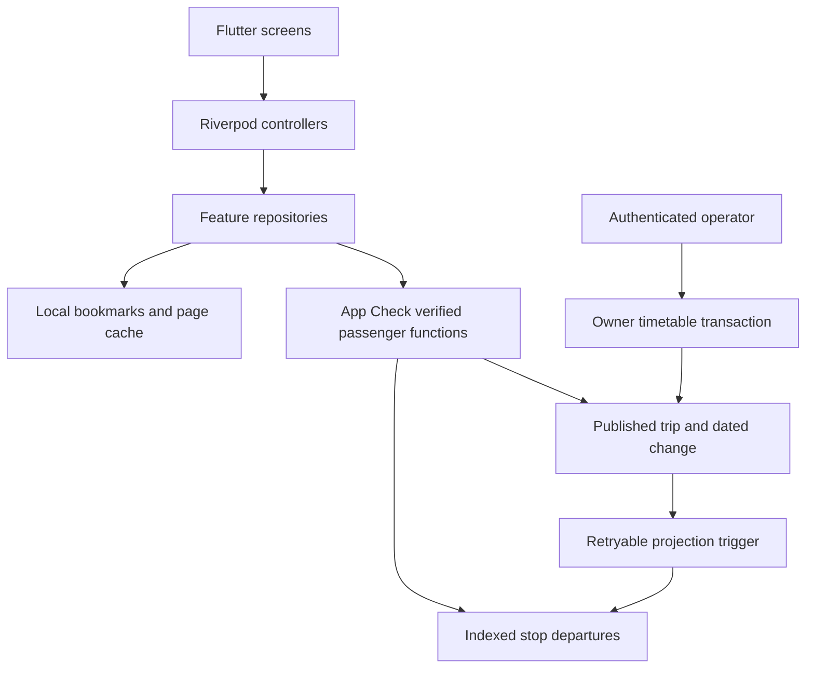

# FindMyBus architecture for one million users

The planning target is one million registered users across Kerala. Passengers can still browse without signing in. Firebase Authentication manages operator accounts and sessions, Firestore stores timetables and service changes, and regional Cloud Functions serve passenger searches. Device-local bookmarks and reminders work without creating an account or writing a passenger profile.

## Traffic model

These are sizing assumptions. Replace them with measured usage during the pilot.

| Input or result | Assumption |
| --- | ---: |
| Registered population | 1,000,000 |
| Daily active riders | 200,000 |
| Searches per active rider per day | 4 |
| Result pages per search | 1.5 |
| Search page requests per day | 1,200,000 |
| Share of daily requests in the busiest hour | 15% |
| Search pages per second during that hour | 50 |
| Fourfold burst target | 200 search pages/s |
| Trip detail opens per search | 0.5 |
| Additional detail lookups during the fourfold burst | ~67/s |

A million simultaneous riders would require a different capacity test. For perspective, a million active clients refreshing once per minute would generate roughly 16,667 requests/s before counting searches. Vehicle GPS streaming has a different write rate and is outside this timetable architecture.

## Passenger and owner requests

- **Passenger search.** Release builds use the indexed passenger API by default. It merges regular and date-specific departures in expected-time order, returns up to four results and uses bound cursors. Each call examines up to 120 candidate rows with an initial batch of five per stream (four results and a lookahead) and subsequent batches of up to 12. The search query fetches just the fields used to rank and validate each row. The regular route directory reads the source timetable without requesting a daily change. Cached and concurrent identical searches on the same warm instance share work for up to ten seconds. A changed stop, service date or page cursor has its own cache identity. Index failures produce an actionable error.
- **Trip details and bookmarks.** A trip ID lookup fetches the published service and the selected date's adjustment in one backend round trip. A regular timetable needs one document. Unpublished services, off days and obsolete schedule revisions are handled explicitly. A user reopening a saved trip does not have to page through other services to find it.
- **Reported vehicle positions.** Opening the tracking screen subscribes to one page of 20 published vehicles plus one lookahead row. Moving to another page switches the listener using a document-ID cursor.
- **Operator writes.** Firebase Auth and Firestore rules scope mutations to the owning account. Transactions protect schedule revisions, trip counts and daily changes. Triggers reread the current source before rebuilding its projection. Deterministic hashed row IDs keep retries idempotent. Old rows are removed when a route shortens. Published timetable rows carry a schedule fingerprint so stale index rows can be rejected while the projection catches up.
- **Accounts and staff.** Firebase Auth owns account identity and sign-in. Operator resources carry the owner UID, and the existing support console checks the admin custom claim. A disabled owner loses access to protected mutations. Private rosters are queried by owner UID. Passenger favourites stay on their device. Opt-in installation metrics and registered-account counts measure different populations.
- **Flutter.** Domain entities and repository interfaces are plain Dart. Firebase, preferences and notification plugins sit in data adapters. Riverpod injects repositories, coalesces shared provider reads, debounces searches and disposes inactive state. The architecture check rejects application `setState` and legacy state APIs. A local cache retains up to 20 first pages, each at most 256 KiB, for at most seven days. Cached pages omit daily running adjustments and are labelled as stale.
- **Operating bounds.** Mumbai (`asia-south1`) passenger callable functions use at most 30 instances each and concurrency 64 per instance. These are configuration ceilings, not measured throughput. Check the actual Firestore database location, available CPU/instance quotas and App Check registration in the target project before rollout. Normalised public responses stay in a bounded per-instance cache. Per-owner and private data bypass that cache. Search logs include duration, candidate documents fetched, source lookups, results and cache outcome. Those counters are diagnostics; use the Cloud billing export for actual charges.

## Deployment and capacity validation

1. In staging, deploy the indexed search and detail functions, rules and composite indexes. Deploy the new `searchTimetables` reader before the projection writers. It accepts both existing weekday keys and compact keys for daily, workweek and weekend services. Backfill existing schedules using `functions/backfill.js`. Keep the compatible reader during rollback if any projections have already been rewritten. Verify a normal service, a date-specific delay, a return trip and an overnight stop. Mark `platform_config/search.ready` true after verifying the projections.
2. Register native Firebase apps and App Check providers. Supply the web App Check site key at build time. Validate a release build with `PAGED_PASSENGER_SEARCH=true`. The existing GitHub Pages deployment retains its previous reader until the repository variable `PAGED_PASSENGER_SEARCH` is enabled or the platform is already enabled. Switch that deployment after the index backfill and App Check test. The independent `PLATFORM_ENABLED` switch enables additional platform features. Keep high-volume passenger traffic on the indexed reader.
3. Target a production-like staging test at 200 searches/s plus 67 detail requests/s for 30 minutes. Include off-peak periods, empty searches, second pages, owner edits, cold starts and a large share of requests on the same two routes. Track end-to-end p95 and p99 latency, error rate, stale-read duration, index backlog, documents read per search and cost per thousand searches. Proposed acceptance targets are search p95 under 1 second, p99 under 2 seconds and errors below 0.5%. Treat those as release criteria until measured.
4. Begin with a small user cohort. Increase traffic while observing error rates, function saturation, database latency and budget alerts. If the error budget is exceeded, pause the rollout and return the cohort to its last verified release. Check the cost of Firestore reads, index storage, functions, network traffic and authentication against actual usage. Verify a backup restore in a separate database before a broad release.

## Local benchmark · 27 November 2026

For local verification, the Firestore emulator suite exercises ownership, cursor ordering, revised timetables and cache sharing. The load harness runs up to 100 concurrent callers against 280 seeded services, records the latency distribution and exits with an error on an incomplete page. Its traffic runs in-process against one cache, so Firebase Auth, App Check, mobile networks, regional autoscaling and cross-instance cache misses require staging measurement.

| Scenario | Concurrent callers | Requests | Errors | Earlier p95 | New p95 | New p99 |
| --- | ---: | ---: | ---: | ---: | ---: | ---: |
| cold | 10 | 40 | 0 | 12,077 ms | 4,063 ms | 4,166 ms |
| shared-cache | 10 | 40 | 0 | 4,700 ms | 663 ms | 663 ms |
| shared-cache | 25 | 100 | 0 | 0 ms | 1 ms | 1 ms |
| shared-cache | 50 | 200 | 0 | 1 ms | 1 ms | 1 ms |
| mixed-routes | 50 | 200 | 0 | 7,011 ms | 2,713 ms | 2,743 ms |
| mixed-routes | 100 | 400 | 0 | 2 ms | 3 ms | 3 ms |
| uncached-mixed-routes | 25 | 100 | 0 | — | 8,451 ms | 9,087 ms |

The 40 uncached searches fetched 200 index documents, down from 480 for the same four results per page. The 100-caller mixed-route case reused already cached pages. The final 25-caller case bypassed the response cache on every request and alternated first and second pages across eight routes. All 1,080 requests returned a complete page. The uncached runs exceeded the proposed one-second p95, and production capacity remains to be measured in staging.

[Firestore query cursors](https://firebase.google.com/docs/firestore/query-data/query-cursors) · [Firestore scaling guidance](https://firebase.google.com/docs/firestore/best-practices) · [Cloud Functions concurrency](https://firebase.google.com/docs/functions/manage-functions)
